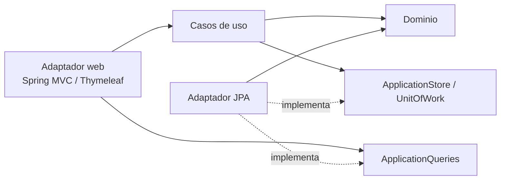

# Job Application Tracker · Hexagonal

Gestor personal de ofertas de empleo, candidaturas, entrevistas y tareas. Es una aplicación local en Java 25 y Spring Boot 4, con arquitectura hexagonal: el dominio y los casos de uso no dependen de frameworks, y la web y PostgreSQL se conectan mediante adaptadores.

## Funcionalidades

- Guardar ofertas antes de solicitar o registrar candidaturas ya enviadas.
- Editar empresa, puesto, enlace, origen, ubicación, modalidad, tecnologías, contacto y notas.
- Cambiar el estado saltando fases, o corregirlo y reabrir procesos indicando un motivo.
- Registrar entrevistas y pruebas técnicas con su resultado.
- Añadir tareas con vencimiento y marcarlas como completadas.
- Buscar y filtrar, consultar el historial de cada candidatura y archivar o restaurar sin perder datos.
- Ver una agenda con próximas entrevistas, entrevistas pendientes de resultado y tareas abiertas.

## Stack

Java 25 (Temurin) · Spring Boot 4.1.2 · Spring MVC · Thymeleaf · Spring Security · Jakarta Validation · Hibernate y Spring Data JPA · PostgreSQL 18.6 · Flyway · Maven Wrapper · Docker Compose.

Para las pruebas y la calidad del código: JUnit 5 · AssertJ · ArchUnit · Playwright · JaCoCo · Spotless · Checkstyle · PMD.

## Arquitectura



```text
src/main/java/dev/adriangm/tracker/
  applications/
    domain/               modelo y reglas, sin frameworks
    application/
      details/            registrar, editar, archivar y restaurar
      status/             cambiar o corregir el estado
      activities/         notas, tareas y entrevistas
      query/              contrato de lectura para listados, ficha y agenda
      ApplicationStore    puerto de salida: recuperar y guardar
      UnitOfWork          puerto de salida: frontera transaccional
      VersionedUpdate     protocolo de versión común a todas las modificaciones
    adapter/
      web/                controladores, formularios, vistas y errores HTTP
      persistence/        entidades JPA, consultas y traducción del modelo
  configuration/          composición de casos de uso, reloj y seguridad
  tools/                  utilidad para generar el hash de la contraseña
```

- **Dominio.** `JobApplication` es una instantánea inmutable. Cada operación valida sus reglas y devuelve una nueva instantánea con su entrada de historial, o la misma si el cambio no tiene efecto.
- **Casos de uso.** Hay uno por operación. Todos los que modifican una candidatura delegan en `VersionedUpdate`, que carga la candidatura, rechaza versiones obsoletas, aplica el cambio y guarda dentro de una unidad de trabajo.
- **Lecturas.** La web consulta `ApplicationQueries` directamente, porque una lectura no aplica reglas de negocio. El adaptador JPA lo implementa con proyecciones paginadas.
- **Concurrencia.** Funciona con bloqueo optimista. Cada formulario envía la versión que mostraba; si no coincide con la guardada, la operación devuelve 409 sin sobrescribir nada. `@Version` cubre además la carrera entre lectura y escritura.
- **Errores HTTP.** 400 para datos o reglas no válidos, 404 para registros inexistentes, 409 para conflictos de versión o identidades repetidas y 403 si falta el token CSRF.

ArchUnit verifica las fronteras: el dominio solo depende de Java, la aplicación no importa frameworks, la web no accede a JPA ni a los puertos de salida, los paquetes de casos de uso no dependen entre sí y solo el dominio y la persistencia pueden reconstruir instantáneas. Las decisiones de diseño, con sus alternativas y costes, están en [docs/adr](docs/adr/README.md).

## Puesta en marcha

Requisitos: Git y Docker con Compose v2. No hace falta instalar Java, Maven ni PostgreSQL.

```bash
make setup   # pide usuario y contraseña, construye la imagen y crea .env
make up      # arranca la aplicación y PostgreSQL y espera a que estén sanos
```

Después abre [localhost:8090](http://localhost:8090). Sin Make, en PowerShell: `./scripts/setup.ps1` y luego `docker compose up -d --wait`. En Bash: `bash scripts/setup.sh` y luego `docker compose up -d --wait`.

`make setup` guarda la contraseña de la aplicación solo como hash bcrypt y genera una contraseña aleatoria para PostgreSQL. Si `.env` ya existe, no lo modifica. Nunca publiques `.env`, los datos ni las copias de seguridad.

| Comando | Uso |
|---|---|
| `make up` / `make down` | Arrancar o detener. Los datos se conservan en el volumen. |
| `make rebuild` | Reconstruir y arrancar después de cambiar el código. |
| `make logs` / `make ps` | Ver los registros o el estado de los servicios. |
| `make backup` | Guardar una copia binaria en `backups/`. |
| `make restore FILE=backups/ARCHIVO.dump` | Restaurar en una base nueva, `tracker_restore`, sin tocar la actual. |
| `make help` | Ver todos los comandos. |

`docker compose down -v` borra los datos. Úsalo solo si de verdad quieres empezar de cero.

### Configuración

| Variable | Por defecto | Uso |
|---|---|---|
| `APP_PORT` | `8090` | Puerto local de la aplicación. Solo se publica en `127.0.0.1`. |
| `TRACKER_ZONE` | `Europe/Madrid` | Zona horaria de las entrevistas. Una hora inexistente o repetida por el cambio de hora se rechaza. |
| `TRACKER_USERNAME`, `TRACKER_PASSWORD_HASH` | Las crea `make setup` | Credenciales del único usuario. |
| `DB_PASSWORD` | La crea `make setup` | Contraseña de PostgreSQL. La base no publica ningún puerto. |

## Pruebas y calidad

```bash
make verify    # análisis estático y tests sin infraestructura
make test      # suite completa con PostgreSQL y navegador, en Docker
make quality   # formato, estilo, complejidad, duplicados y arquitectura
make format    # aplicar el formato
```

En PowerShell: `./scripts/test.ps1` y `./scripts/quality.ps1`. La suite completa usa una base de datos temporal, separada de la de la aplicación, y la elimina al terminar. Los informes se guardan en `target/surefire-reports`, `target/failsafe-reports` y `target/site/jacoco`; las capturas del recorrido en navegador, hechas con datos ficticios, en `target/screenshots`. El CI de GitHub Actions ejecuta los mismos scripts.

| Nivel | Qué comprueba |
|---|---|
| Dominio y casos de uso | Reglas, transiciones y coordinación, sin Spring. |
| Contrato de `ApplicationStore` | Las mismas pruebas contra la implementación en memoria y contra PostgreSQL. |
| `PersistenceIT` | Migraciones, rollback de estado e historial, escrituras concurrentes y consultas. |
| `WebIT` | Inicio de sesión, CSRF, códigos HTTP y escape de HTML. |
| `BrowserWorkflowIT` | El recorrido diario completo con Playwright, comprobando que no haya desbordamiento horizontal en escritorio ni en móvil. |
| `ArchitectureTest` | Fronteras entre capas y paquetes. |

El código sigue [Google Java Style](https://google.github.io/styleguide/javaguide.html), aplicado con Spotless. Las reglas de [Checkstyle](config/checkstyle.xml) y [PMD](config/pmd.xml) se aplican a producción y tests, y cualquier infracción hace fallar la construcción:

| Criterio | Límite |
|---|---|
| Método | Hasta 50 líneas no vacías y menos de 30 sentencias. |
| Complejidad | Cognitiva menor de 10 y ciclomática menor de 8. |
| Parámetros | Hasta 8. |
| Anidamiento | Hasta dos niveles; expresiones booleanas con hasta tres operadores. |
| Duplicación | Ningún bloque repetido de 100 tokens o más. |

Para trabajar desde un IDE necesitas un JDK 25. `./mvnw test` ejecuta los tests rápidos sin PostgreSQL.

## Operación

- **Registros.** Son estructurados y cada petición lleva un `requestId`, que también se devuelve en la cabecera `X-Request-ID`. No incluyen notas ni credenciales.
- **Salud y métricas.** `/actuator/health` es público y no muestra componentes. `/actuator/metrics` requiere sesión.
- **Datos de ejemplo.** `scripts/demo.sql` contiene datos ficticios: `docker compose exec -T db psql -U tracker -d tracker < scripts/demo.sql`.
- **Actualizaciones.** No modifiques una migración ya aplicada: añade una nueva. Pasar a otra versión mayor de PostgreSQL requiere migrar los datos.

## Alcance

Uso personal y local, con un solo usuario. No tiene API REST, adjuntos ni integraciones externas. El HTTP local no está preparado para exponerse a Internet. Ningún ejemplo, test ni captura contiene datos personales reales.
